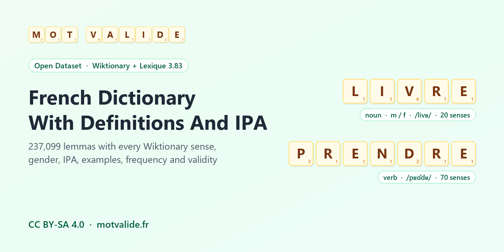

# French Dictionary With Definitions, IPA And Frequency



**English first, version française complète plus bas.**

## How Many Meanings Does "Prendre" Have?

Seventy, according to French Wiktionary. *Pièce* has 61, *faire* 60, *donner* 51. Here every sense of a lemma sits in one row, with its examples, ready to explore.

This dataset is a French dictionary in CSV, built for analysis. The main file holds **237,099 lemmas, one row per lemma and part of speech, with no inflections and no demonyms mixed in**. It carries 354,667 human-written definitions and 435,405 usage examples, and each lemma comes with its gender, its **IPA pronunciation**, its usage and regional labels, its frequency in real French, and whether it is valid in Scrabble according to Mot Valide. The 76,602 demonyms get their own file with the place and department they refer to, and a third table links **154,379 inflected forms** to their lemma, with mood, tense and person already split into columns.

It is built directly from French Wiktionary and enriched with Lexique 3.83 and wordfreq.

## Load It

The three tables are gzipped CSV files in [`data/`](data/). pandas reads them directly.

```python
import json
import pandas as pd

lemmas = pd.read_csv("data/lemmas.csv.gz", keep_default_na=False)
row = lemmas[lemmas.lemma == "livre"].iloc[0]
print(row.ipa, row.gender, json.loads(row.definitions)[:3])
```

## What's Inside

| File | Rows | What it holds |
|---|---|---|
| `lemmas.csv` | 237,099 | The vocabulary, one row per (lemma, part of speech), sorted from most to least frequent |
| `demonyms.csv` | 76,602 | Words for the inhabitants of a place (*parisien*) and the matching adjectives, with the place and department |
| `forms.csv` | 154,379 | Attested inflected forms linked to their lemma, one row per grammatical analysis |

**`lemmas.csv` columns.** `lemma`, `pos` (noun, verb, adjective, adverb...), `pos_fr`, `gender` (m, f, mf or empty), `gender_source`, `definition` (main sense), `definitions` (JSON list of every sense, in order), `sense_count`, `example`, `examples` (JSON list of up to 3 examples per sense, aligned with `definitions`), `register` (familiar, dated, slang...), `domain` (botany, medicine, nautical...), `region` (Québec, Belgique, Suisse...), `ipa`, `phonetic`, `syllables`, `syllable_count`, `zipf_frequency`, `frequency_band`, `lexique_freq_films`, `lexique_freq_books`, `scrabble_form`, `scrabble_valid`, `motvalide_url`.

**`demonyms.csv` columns.** `lemma`, `pos` (noun or adjective), `gender`, `place` (Beaux, Le Mans...), `department` (Haute-Loire, Sarthe...), `definition`, `definitions`, `sense_count`, `ipa`, `zipf_frequency`, `scrabble_form`, `scrabble_valid`, `motvalide_url`.

**`forms.csv` columns.** `form`, `lemma`, `pos`, `lexique_cgram`, `gender`, `number`, `mood`, `tense`, `person`, `lexique_infover`, `is_lemma`, `phonetic`, `zipf_frequency`, `lexique_freq_films`, `lexique_freq_books`, `scrabble_valid`, `has_definition`, `motvalide_url`. A form like *parle* gets five rows (indicative present 1 and 3, subjunctive present 1 and 3, imperative 2), so you can filter on any analysis directly. `has_definition` is 1 when the lemma has a row in `lemmas.csv` or `demonyms.csv`.

## What Makes It Easy To Use

Most open French dictionaries are raw exports, with one row per sense or per inflected form and little else. This one is organised for analysis.

- **One row per lemma.** Inflected forms (« Pluriel de chêne. ») are left out of the main file and covered by a structured table, `forms.csv`, with mood, tense, person and number in separate columns.
- **Demonyms apart.** The 76,602 words for the inhabitants of a place sit in `demonyms.csv`, with the place and department already extracted.
- **IPA for 91.4% of lemmas** (97.5% of the words with a Zipf frequency of 3 or more), plus Lexique's phonetic notation and syllables for the common vocabulary.
- **Gender for 99.0% of nouns.**
- **Examples aligned with senses**, for 178,182 lemmas.
- **Usage frequency** from wordfreq, plus Lexique per-million counts from films and books.
- **Scrabble validity** on every row (86,822 valid lemmas), with a link to the word page on Mot Valide.

## Where The Data Comes From

1. **Definitions, examples, gender, IPA and usage labels** come from French [Wiktionary](https://fr.wiktionary.org/), read through the [kaikki.org](https://kaikki.org/) extraction made with [wiktextract](https://github.com/tatuylonen/wiktextract) (September 2026 dump, CC BY-SA 4.0). The text is written by Wiktionary contributors and is kept as they wrote it.
2. **Inflected forms, phonetic notation, syllables and corpus frequencies** come from [Lexique 3.83](http://www.lexique.org/) by Boris New and Christophe Pallier (CC BY-SA 4.0). Its frequencies are counted in film subtitles and in books.
3. **Usage frequency** comes from [wordfreq](https://github.com/rspeer/wordfreq) by Robyn Speer (CC BY-SA 4.0), on the Zipf scale, where 6 means once every thousand words and 3 once per million.
4. **Scrabble validity** comes from the word list behind [Mot Valide](https://www.motvalide.fr/), a free French Scrabble word checker holding 412,101 valid word forms.

## How The Rows Were Built

Only single-word lemmas are kept. Inflected forms, proper nouns and multi-word phrases are set aside, and letters with an optional hyphen or apostrophe are allowed (*aujourd'hui*, *arc-boutant*). Senses of the same lemma and part of speech are gathered into one row, in the order Wiktionary gives them. A lemma whose main sense names the inhabitants of a place, or relates to a place, goes to `demonyms.csv`.

The definitions themselves were not rewritten. Senses that were empty, visibly truncated, placeholders or duplicates were dropped, as were bare pointers to another form (« Forme pronominale de... »). When a word has other meanings, its demonym senses are placed last, so *beau* stays in the main file with its main meaning first rather than "inhabitant of Beaux".

## Patterns Worth Noting

**1. One lemma in four is an inhabitant of a village.** Before the split, 76,602 of 313,701 lemma rows (24.4%) were demonyms, 52,386 nouns and 24,216 adjectives, and 93.2% of them name a French commune. They cover 25,786 places in 108 departments, led by the Pas-de-Calais (1,972 rows). Only 2.4% are valid in Scrabble.

**2. Meanings pile up on frequent words.** 77.1% of the lemmas have a single sense. Very common lemmas average 6.4 senses, rare ones 1.22. The most polysemous everyday words are *prendre* (70), *pièce* (61), *faire* (60), *donner* (51), *passer* (50) and *tirer* (50).

**3. Verbs punch above their weight.** Nouns make up 62.4% of rows and 63.8% of senses, adjectives 20.3% and 18.2%. Verbs are 14.8% of rows but 15.8% of senses, with 1.60 senses each against 1.53 for nouns.

**4. Masculine leads.** Nouns are 54.7% masculine, 38.5% feminine and 6.8% both. Among common nouns (Zipf 3 or more) the split is 51.4% masculine, 37.7% feminine and 10.9% both. "Both" covers words like *livre*, *tour*, *mode*, *poste*, *manche* and *voile*, whose meaning changes with the gender.

**5. French is not only the French of France.** 11,319 lemmas carry a regional label. Québec leads (1,956 lemmas), ahead of Switzerland (1,376), Canada (1,295) and Belgium (954), and 1,401 lemmas have a sense labelled as specific to France.

**6. Common words are almost always playable.** 92.1% of lemmas with Zipf 3 or more are valid in Scrabble according to Mot Valide, against 27.3% in the rare band. The whole file is 36.6% playable.

**7. Most of the dictionary is rarely used.** 73.0% of lemmas fall in the rare band, and 142,033 have a Zipf of 0, which means wordfreq never saw them.

## Caveats

- **One frequency per spelling.** `zipf_frequency` belongs to the written word, not to the meaning. *Et* the noun inherits the score of the conjunction.
- **Compounds have no Zipf.** wordfreq splits *peut-être* into two tokens, so the 20,314 hyphenated or elided lemmas have an empty `zipf_frequency`. Use `lexique_freq_films` for those when it is filled.
- **Labels are in English.** `register` and `domain` use the English tags of the extraction (familiar, dated, botany, nautical). `region` keeps the French place names.
- **Two pronunciation columns.** `ipa` is the Wiktionary IPA with syllable dots (*livre* is `livʁ`, *rapport* is `ʁa.pɔʁ`). `phonetic` is Lexique's own one-character notation (*chat* is `Sa`) and only covers words Lexique knows.
- **Gender can be meaning-dependent.** The value `mf` mixes nouns of both genders (*élève*) and nouns whose meaning depends on gender (*livre*).
- **Text is kept as written.** Sense order follows the source page, and some senses carry an inline usage note.
- **Places are parsed from the text.** In `demonyms.csv`, the article folded into *du* or *des* is restored (*Habitant du Mans* gives Le Mans), and department names are kept as Wiktionary spells them.
- **Validity is about letters.** `scrabble_form` drops accents, hyphens and apostrophes, so *peut-être* is checked as PEUTETRE. Word lists are revised every few years, and this file reflects Mot Valide's list in October 2026.

## Ideas

- Build a definition game, a crossword helper or flashcards, using `frequency_band` to pick words people know.
- Train a grapheme-to-phoneme model on `lemma` and `ipa`.
- Fine-tune or evaluate a French language model on word sense, with `definitions` and aligned `examples`.
- Lemmatize or generate conjugations with `forms.csv`, then join to `lemmas.csv` for meanings.
- Study regional French with `region`, or grammatical gender with `gender`, `ipa` and word endings.
- Map French demonyms by department with `demonyms.csv`, or test how predictable they are from the place name.

A starter notebook, [French Dictionary Clean & Enriched Starter](https://www.kaggle.com/code/cuivrax/french-dictionary-clean-enriched-starter), loads the tables and charts the patterns above. Two sibling datasets cover related needs. [French Word Frequency And Scrabble Validity](https://www.kaggle.com/datasets/cuivrax/french-word-frequency-scrabble-validity) gives frequency and validity for every written French word, and [French Wordle, Sutom And Hangman Word Lists](https://www.kaggle.com/datasets/cuivrax/french-word-games-starter-pack) is ready to drop into a word game. The same tables are also on [Kaggle](https://www.kaggle.com/datasets/cuivrax/french-dictionary-clean-enriched) and [Hugging Face](https://huggingface.co/datasets/verbarium/french-dictionary-clean-enriched).

## Credits And License

- **Wiktionary contributors**, for every definition, example and pronunciation ([fr.wiktionary.org](https://fr.wiktionary.org/), CC BY-SA 4.0).
- **Tatu Ylonen**, for [wiktextract](https://github.com/tatuylonen/wiktextract) and the [kaikki.org](https://kaikki.org/) extraction. Please cite Ylonen, T. (2022). Wiktextract: Wiktionary as Machine-Readable Structured Data. *Proceedings of LREC 2022*, 1317-1325.
- **Boris New and Christophe Pallier**, for [Lexique 3.83](http://www.lexique.org/) (CC BY-SA 4.0). Please cite New, B., Pallier, C., Brysbaert, M., and Ferrand, L. (2004). Lexique 2 : A New French Lexical Database. *Behavior Research Methods, Instruments, & Computers*, 36(3), 516-524.
- **Robyn Speer**, for [wordfreq](https://github.com/rspeer/wordfreq) (CC BY-SA 4.0).
- **Mot Valide** ([motvalide.fr](https://www.motvalide.fr/)), for the Scrabble word list and the compilation.

The dataset is shared under **CC BY-SA 4.0**, the license of all its sources. If you use it, please credit "Mot Valide (motvalide.fr), definitions from French Wiktionary, Lexique 3.83, wordfreq". Scrabble is a trademark of its respective owners. Mot Valide is an independent site, not affiliated with them.

## About

Compiled by [Mot Valide](https://www.motvalide.fr/), a free French Scrabble word checker. Every row links to its word page (`motvalide_url`), for example [LIVRE](https://www.motvalide.fr/mot/livre) or [PRENDRE](https://www.motvalide.fr/mot/prendre), with points, anagrams and related words. You can also browse the [valid two-letter words](https://www.motvalide.fr/mots/2-lettres) or solve a rack with the [anagram finder](https://www.motvalide.fr/anagrammeur).

---

## Version Française

### Combien De Sens A Le Verbe « Prendre » ?

Soixante-dix, selon le Wiktionnaire. *Pièce* en a 61, *faire* 60, *donner* 51. Ici, tous les sens d'un lemme tiennent sur une seule ligne, avec leurs exemples, prêts à être explorés.

Ce jeu de données est un dictionnaire français au format CSV, pensé pour l'analyse. Le fichier principal contient **237 099 lemmes, une ligne par lemme et par catégorie grammaticale, sans flexions ni gentilés mélangés**. Il réunit 354 667 définitions rédigées par des humains et 435 405 exemples d'usage, et chaque lemme est accompagné de son genre, de sa **prononciation en API**, de ses marques d'usage et de région, de sa fréquence d'usage et de sa validité au Scrabble selon Mot Valide. Les 76 602 gentilés ont leur propre fichier, avec le lieu et le département concernés, et une troisième table relie **154 379 formes fléchies** à leur lemme, avec le mode, le temps et la personne déjà séparés en colonnes.

Il est construit directement à partir du Wiktionnaire, puis enrichi avec Lexique 3.83 et wordfreq.

### Contenu

| Fichier | Lignes | Contenu |
|---|---|---|
| `lemmas.csv` | 237 099 | Le vocabulaire, une ligne par (lemme, catégorie grammaticale), du plus fréquent au plus rare |
| `demonyms.csv` | 76 602 | Les noms d'habitants (*parisien*) et les adjectifs correspondants, avec le lieu et le département |
| `forms.csv` | 154 379 | Formes fléchies attestées reliées à leur lemme, une ligne par analyse grammaticale |

**Colonnes de `lemmas.csv`.** `lemma`, `pos` (noun, verb, adjective, adverb...), `pos_fr` (nom, verbe, adjectif...), `gender` (m, f, mf ou vide), `gender_source`, `definition` (sens principal), `definitions` (liste JSON de tous les sens, dans l'ordre), `sense_count`, `example`, `examples` (liste JSON d'au plus 3 exemples par sens, alignée sur `definitions`), `register` (familiar, dated, slang...), `domain` (botany, medicine, nautical...), `region` (Québec, Belgique, Suisse...), `ipa`, `phonetic`, `syllables`, `syllable_count`, `zipf_frequency`, `frequency_band`, `lexique_freq_films`, `lexique_freq_books`, `scrabble_form`, `scrabble_valid`, `motvalide_url`.

**Colonnes de `demonyms.csv`.** `lemma`, `pos` (nom ou adjectif), `gender`, `place` (Beaux, Le Mans...), `department` (Haute-Loire, Sarthe...), `definition`, `definitions`, `sense_count`, `ipa`, `zipf_frequency`, `scrabble_form`, `scrabble_valid`, `motvalide_url`.

**Colonnes de `forms.csv`.** `form`, `lemma`, `pos`, `lexique_cgram`, `gender`, `number`, `mood`, `tense`, `person`, `lexique_infover`, `is_lemma`, `phonetic`, `zipf_frequency`, `lexique_freq_films`, `lexique_freq_books`, `scrabble_valid`, `has_definition`, `motvalide_url`. Une forme comme *parle* a cinq lignes (indicatif présent 1 et 3, subjonctif présent 1 et 3, impératif 2), ce qui permet de filtrer directement sur n'importe quelle analyse. `has_definition` vaut 1 quand le lemme a une ligne dans `lemmas.csv` ou `demonyms.csv`.

### Ce Qui Le Rend Facile À Utiliser

La plupart des dictionnaires français ouverts sont des exports bruts, avec une ligne par sens ou par forme fléchie et peu d'informations en plus. Celui-ci est organisé pour l'analyse.

- **Une ligne par lemme.** Les formes fléchies (« Pluriel de chêne. ») sont écartées du fichier principal et couvertes par une table structurée, `forms.csv`, avec le mode, le temps, la personne et le nombre en colonnes séparées.
- **Les gentilés à part.** Les 76 602 noms d'habitants sont dans `demonyms.csv`, avec le lieu et le département déjà extraits.
- **L'API pour 91,4 % des lemmes** (97,5 % des mots d'une fréquence Zipf de 3 ou plus), plus la notation phonétique et les syllabes de Lexique pour le vocabulaire courant.
- **Le genre pour 99,0 % des noms.**
- **Des exemples alignés sur les sens**, pour 178 182 lemmes.
- **Fréquence d'usage** de wordfreq, avec les fréquences par million de Lexique pour les films et les livres.
- **Validité au Scrabble** sur chaque ligne (86 822 lemmes valides), avec un lien vers la page du mot sur Mot Valide.

### D'où Viennent Les Données

1. **Les définitions, exemples, genres, prononciations en API et marques d'usage** viennent du [Wiktionnaire](https://fr.wiktionary.org/), lu à travers l'extraction [kaikki.org](https://kaikki.org/) réalisée avec [wiktextract](https://github.com/tatuylonen/wiktextract) (export de septembre 2026, CC BY-SA 4.0). Le texte est écrit par les contributeurs du Wiktionnaire et conservé tel quel.
2. **Les formes fléchies, la notation phonétique, les syllabes et les fréquences de corpus** viennent de [Lexique 3.83](http://www.lexique.org/) de Boris New et Christophe Pallier (CC BY-SA 4.0). Ses fréquences sont comptées dans des sous-titres de films et dans des livres.
3. **La fréquence d'usage** vient de [wordfreq](https://github.com/rspeer/wordfreq) de Robyn Speer (CC BY-SA 4.0), sur l'échelle de Zipf. 6 signifie une fois tous les mille mots, 3 une fois par million.
4. **La validité au Scrabble** vient de la liste de mots de [Mot Valide](https://www.motvalide.fr/), vérificateur gratuit de mots pour le Scrabble qui compte 412 101 formes valides.

### Comment Les Lignes Ont Été Construites

Seuls les lemmes d'un seul mot sont gardés. Les formes fléchies, les noms propres et les locutions sont mis de côté, et les lettres avec un trait d'union ou une apostrophe interne sont acceptées (*aujourd'hui*, *arc-boutant*). Les sens d'un même lemme et d'une même catégorie sont réunis sur une ligne, dans l'ordre donné par le Wiktionnaire. Un lemme dont le sens principal désigne les habitants d'un lieu, ou se rapporte à un lieu, va dans `demonyms.csv`.

Les définitions elles-mêmes n'ont pas été réécrites. Les sens vides, visiblement tronqués, laissés en attente ou en double ont été retirés, tout comme les simples renvois vers une autre forme (« Forme pronominale de... »). Quand un mot a d'autres sens, ses sens de gentilé passent en dernier, si bien que *beau* reste dans le fichier principal avec son sens courant en tête plutôt que « habitant de Beaux ».

### Ce Que Montrent Les Données

**1. Un lemme sur quatre est un habitant de village.** Avant la séparation, 76 602 des 313 701 lignes de lemmes (24,4 %) étaient des gentilés, 52 386 noms et 24 216 adjectifs, et 93,2 % d'entre eux désignent une commune française. Ils couvrent 25 786 lieux dans 108 départements, le Pas-de-Calais en tête (1 972 lignes). Seuls 2,4 % sont valides au Scrabble.

**2. Les sens s'accumulent sur les mots fréquents.** 77,1 % des lemmes n'ont qu'un seul sens. Les lemmes très courants ont en moyenne 6,4 sens, les rares 1,22. Les mots courants les plus polysémiques sont *prendre* (70), *pièce* (61), *faire* (60), *donner* (51), *passer* (50) et *tirer* (50).

**3. Les verbes pèsent plus que leur nombre.** Les noms forment 62,4 % des lignes et 63,8 % des sens, les adjectifs 20,3 % et 18,2 %. Les verbes font 14,8 % des lignes mais 15,8 % des sens, avec 1,60 sens chacun contre 1,53 pour les noms.

**4. Le masculin domine.** Les noms sont à 54,7 % masculins, 38,5 % féminins et 6,8 % des deux genres. Parmi les noms courants (Zipf 3 ou plus), la répartition est de 51,4 % de masculins, 37,7 % de féminins et 10,9 % des deux. Les « deux genres » incluent *livre*, *tour*, *mode*, *poste*, *manche* et *voile*, dont le sens change avec le genre.

**5. Le français ne se limite pas à celui de France.** 11 319 lemmes portent une marque régionale. Le Québec arrive en tête (1 956 lemmes), devant la Suisse (1 376), le Canada (1 295) et la Belgique (954), et 1 401 lemmes ont un sens marqué comme propre à la France.

**6. Les mots courants sont presque toujours jouables.** 92,1 % des lemmes de Zipf 3 ou plus sont valides au Scrabble selon Mot Valide, contre 27,3 % dans la tranche rare. Le fichier est jouable à 36,6 % au total.

**7. L'essentiel du dictionnaire sert peu.** 73,0 % des lemmes sont dans la tranche rare, et 142 033 ont un Zipf de 0, ce qui veut dire que wordfreq ne les a jamais rencontrés.

### Limites

- **Une fréquence par orthographe.** `zipf_frequency` appartient au mot écrit, pas au sens. *Et* le nom hérite du score de la conjonction.
- **Les mots composés n'ont pas de Zipf.** wordfreq découpe *peut-être* en deux mots, si bien que les 20 314 lemmes à trait d'union ou à élision ont un `zipf_frequency` vide. Utilisez `lexique_freq_films` quand il est renseigné.
- **Les étiquettes sont en anglais.** `register` et `domain` reprennent les étiquettes anglaises de l'extraction (familiar, dated, botany, nautical). `region` garde les noms de lieux en français.
- **Deux colonnes de prononciation.** `ipa` est l'API du Wiktionnaire avec les points de syllabe (*livre* donne `livʁ`, *rapport* donne `ʁa.pɔʁ`). `phonetic` est la notation de Lexique à un caractère par son (*chat* donne `Sa`) et ne couvre que les mots connus de Lexique.
- **Le genre peut dépendre du sens.** La valeur `mf` mélange les noms des deux genres (*élève*) et ceux dont le sens dépend du genre (*livre*).
- **Le texte reste tel qu'écrit.** L'ordre des sens suit la page source, et certains sens contiennent une note d'usage.
- **Les lieux sont extraits du texte.** Dans `demonyms.csv`, l'article contenu dans *du* ou *des* est rétabli (*Habitant du Mans* donne Le Mans), et les noms de départements sont gardés tels que le Wiktionnaire les écrit.
- **La validité porte sur les lettres.** `scrabble_form` retire accents, traits d'union et apostrophes, donc *peut-être* est vérifié comme PEUTETRE. Les listes de mots sont révisées tous les quelques années, et ce fichier reflète la liste de Mot Valide en octobre 2026.

### Idées D'utilisation

- Créer un jeu de définitions, une aide aux mots croisés ou des cartes mémoire, en choisissant des mots connus avec `frequency_band`.
- Entraîner un modèle de conversion graphème-phonème avec `lemma` et `ipa`.
- Entraîner ou évaluer un modèle de langue sur le sens des mots, avec `definitions` et les `examples` alignés.
- Lemmatiser ou générer des conjugaisons avec `forms.csv`, puis joindre `lemmas.csv` pour les sens.
- Étudier le français régional avec `region`, ou le genre grammatical avec `gender`, `ipa` et les terminaisons.
- Cartographier les gentilés par département avec `demonyms.csv`, ou mesurer à quel point ils se devinent à partir du nom du lieu.

Un carnet de démarrage, [French Dictionary Clean & Enriched Starter](https://www.kaggle.com/code/cuivrax/french-dictionary-clean-enriched-starter), charge les tables et illustre ces tendances en graphiques. Deux jeux de données voisins répondent à des besoins proches. [French Word Frequency And Scrabble Validity](https://www.kaggle.com/datasets/cuivrax/french-word-frequency-scrabble-validity) donne la fréquence et la validité de tous les mots français écrits, et [French Wordle, Sutom And Hangman Word Lists](https://www.kaggle.com/datasets/cuivrax/french-word-games-starter-pack) est prêt à intégrer dans un jeu de lettres. Les mêmes tables sont aussi sur [Kaggle](https://www.kaggle.com/datasets/cuivrax/french-dictionary-clean-enriched) et [Hugging Face](https://huggingface.co/datasets/verbarium/french-dictionary-clean-enriched).

### Crédits Et Licence

- **Les contributeurs du Wiktionnaire**, pour chaque définition, chaque exemple et chaque prononciation ([fr.wiktionary.org](https://fr.wiktionary.org/), CC BY-SA 4.0).
- **Tatu Ylonen**, pour [wiktextract](https://github.com/tatuylonen/wiktextract) et l'extraction [kaikki.org](https://kaikki.org/). Merci de citer Ylonen, T. (2022). Wiktextract: Wiktionary as Machine-Readable Structured Data. *Proceedings of LREC 2022*, 1317-1325.
- **Boris New et Christophe Pallier**, pour [Lexique 3.83](http://www.lexique.org/) (CC BY-SA 4.0). Merci de citer New, B., Pallier, C., Brysbaert, M., et Ferrand, L. (2004). Lexique 2 : A New French Lexical Database. *Behavior Research Methods, Instruments, & Computers*, 36(3), 516-524.
- **Robyn Speer**, pour [wordfreq](https://github.com/rspeer/wordfreq) (CC BY-SA 4.0).
- **Mot Valide** ([motvalide.fr](https://www.motvalide.fr/)), pour la liste de mots du Scrabble et la compilation.

Le jeu de données est sous licence **CC BY-SA 4.0**, celle de toutes ses sources. Si vous l'utilisez, merci de citer « Mot Valide (motvalide.fr), définitions du Wiktionnaire, Lexique 3.83, wordfreq ». Scrabble est une marque déposée de ses propriétaires respectifs. Mot Valide est un site indépendant, sans lien avec eux.

### À Propos

Réalisé par [Mot Valide](https://www.motvalide.fr/), vérificateur gratuit de mots pour le Scrabble. Chaque ligne renvoie à la page du mot (`motvalide_url`), par exemple [LIVRE](https://www.motvalide.fr/mot/livre) ou [PRENDRE](https://www.motvalide.fr/mot/prendre), avec ses points, ses anagrammes et les mots proches. Vous pouvez aussi consulter les [mots valides de deux lettres](https://www.motvalide.fr/mots/2-lettres) ou résoudre un tirage avec l'[anagrammeur](https://www.motvalide.fr/anagrammeur).

---

**Part of [French Word Dictionaries And Word Lists](https://github.com/verbarium/french-word-dictionaries)** by Verbarium. Data by [Mot Valide](https://www.motvalide.fr/). Also on [Kaggle](https://www.kaggle.com/datasets/cuivrax/french-dictionary-clean-enriched) and [Hugging Face](https://huggingface.co/datasets/verbarium/french-dictionary-clean-enriched).
